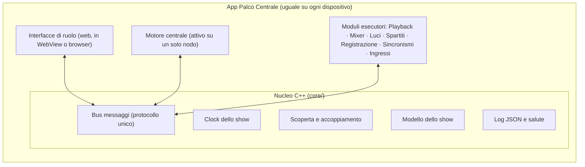
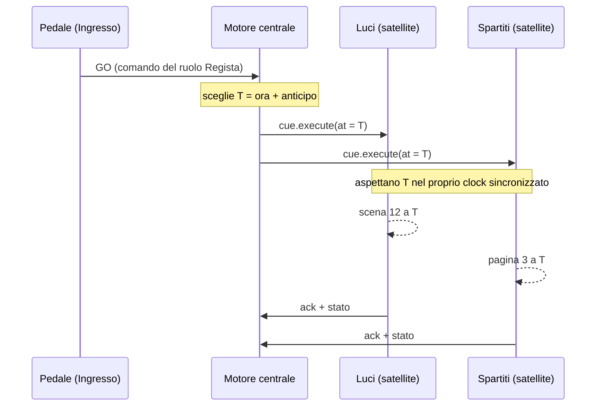

# Palco Centrale – Architettura generale

Stato: **bozza** · 23 ottobre 2026 · thread "Architettura generale"

Questo documento descrive come è fatto il sistema: quali pezzi esistono, dove girano e come si parlano. Si aggiorna ogni volta che un thread Txx prende una decisione che lo tocca; la tabella in fondo dice da dove viene ogni scelta.

Fonti: documento di riferimento "Palco Centrale – Istruzioni e ossatura", requisiti T02 (`docs/requirements/requisiti-v1.md`, PR #2), ADR 0001-0005 di T01 (PR #1). La decisione strutturale, scelta da Luca il 2026-10-23, è registrata in [ADR 0006](../adr/0006-motore-centrale-e-satelliti.md).

## 1. In una frase

Ogni dispositivo esegue **la stessa app**, che contiene un nucleo comune e dei moduli; in ogni show **un nodo ospita il motore centrale** (scaletta, clock, stato autorevole) e gli altri nodi sono **satelliti** che ricevono in anticipo cosa fare e quando, ed eseguono da soli anche se la rete cade.

## 2. Concetti e come si combinano

| Concetto | Cos'è | Esempi |
| --- | --- | --- |
| **Nodo** | Un'istanza dell'app su un dispositivo | App sul tablet, app sul Mac, browser sul telefono |
| **Motore centrale** | Servizio unico per show: clock master, show caricato, motore dei cue e del trasporto, registro dei nodi | Gira sul tablet in C1, sul Mac in C3 |
| **Modulo esecutore** | Fa qualcosa nel mondo reale, comandato dal motore | Playback, Mixer, Luci, Spartiti, Registrazione, Sincronismi, Ingressi |
| **Ruolo** | Vista e permessi per una persona: un insieme di schermate e comandi | Regista, Fonico, Musicista/Attore, Tecnico luci |
| **Ingresso** | Sorgente di comandi, non un ruolo | Pedale, tasto, controller MIDI, tocco |
| **Dispositivo esterno** | Apparato fuori da Palco Centrale | Mixer fisico (OSC/MIDI), nodo DMX, effetti chitarra (MIDI) |

Regole di composizione:

- Un nodo ospita **zero o un motore**, **zero o più moduli** (quelli che il suo hardware consente) e **zero o più interfacce di ruolo**.
- Un ruolo non è legato a un nodo: la stessa interfaccia del Regista si apre sul tablet che ospita il motore o su un telefono satellite.
- Un modulo esecutore gira dove è collegato il suo hardware (il Mixer dove c'è l'interfaccia audio, le Luci dove c'è l'uscita DMX/Art-Net).



## 3. I moduli

| Modulo | Cartella | Ruolo che lo usa | Cosa fa | Tempo reale | Thread |
| --- | --- | --- | --- | --- | --- |
| Motore centrale | `modules/engine/` | tutti | Clock master, show attivo, cue e trasporto, registro e salute dei nodi, permessi | No | T06, T07, T08, T17 |
| Regia (UI) | `ui/` ruolo Regista | Regista | Scrive la scaletta, GO, salti, stato dei nodi | No | T10 |
| Playback | `modules/playback/` | Fonico | Basi, click, effetti sonori | **Sì** (thread audio) | T11 |
| Mixer | `modules/mixer/` | Fonico, Musicista | Mixer software: main + N mandate, mix personali; controllo mixer esterni | **Sì** | T12 |
| Luci | `modules/lighting/` | Tecnico luci | Scene, chase a tempo, uscita Art-Net/sACN/DMX USB | Morbido (~44 Hz) | T13 |
| Spartiti | `modules/score/` | Musicista/Attore | Importatori a plugin (ChordPro, poi Guitar Pro, PDF, MusicXML), scorrimento a tempo, sopratitoli | No (UI) | T14 |
| Registrazione | `modules/recorder/` | Fonico | Multitraccia con marker di brano e cue | **Sì** | T15 |
| Sincronismi | `modules/sync/` | Fonico | MIDI Clock, MTC, LTC, OSC generico, Program Change | Morbido | T16 |
| Ingressi | `modules/input/` | tutti | Traduce pedale, tasti, MIDI in comandi del ruolo | No | T08, T18 |

Nota: il documento di riferimento unisce "regia" e "master". Qui sono separati: il **motore** è un servizio senza interfaccia, la **regia** è un'interfaccia di ruolo. Così il motore può stare sul tablet della one man band e la regia aprirsi anche altrove.

Ogni modulo esecutore ha la stessa forma:

1. **Lato controllo**: riceve comandi dal bus, tiene il proprio stato, pubblica salute (OK, degradato, offline).
2. **Lato esecuzione**: per i moduli in tempo reale, il thread audio legge comandi già programmati da una coda lock-free preallocata. Niente allocazioni, lock, I/O o log nel thread audio.
3. **Adattatori hardware** dietro un'interfaccia, con un **simulatore** per ognuno (audio finto, DMX finto, MIDI finto), così ogni modulo si prova senza hardware.

## 4. I tre piani di comunicazione

| Piano | Cosa porta | Trasporto | Garanzia | Thread |
| --- | --- | --- | --- | --- |
| **Controllo** | Comandi, stato, show, timeline, salute, log | WebSocket su TCP, JSON (MessagePack opzionale) | Affidabile e ordinato | T04 |
| **Clock** | Scambi di sincronizzazione stile PTP/NTP | UDP | Veloce, i pacchetti persi si ignorano | T06 |
| **Media** | Audio tra nodi | UDP/RTP | **Fuori dalla v1** *(da confermare in T02)*: l'audio resta locale al nodo con l'interfaccia | T04, dopo |

Più due servizi di contorno:

- **Scoperta**: mDNS/DNS-SD, il motore si annuncia, i satelliti lo trovano (T05).
- **Accoppiamento**: un codice mostrato dal motore; senza accoppiamento i comandi vengono ignorati e registrati nel log (T05).

Tutti i messaggi viaggiano in una **busta unica** con: versione del protocollo, ID del nodo mittente, ID dello show, numero di sequenza, show time di emissione, ed eventualmente show time di esecuzione. Lo schema si scrive in `docs/protocol/` prima del codice (T04).

### Un solo bus, locale o in rete

Regola del documento di riferimento: nessun modulo parla direttamente con un altro, anche sullo stesso computer. Il nucleo offre un **bus** con due trasporti intercambiabili:

- **Locale (in-process)**: stessi messaggi, passati in memoria. È il caso della one man band su un tablet, dove motore, spartiti e ingressi girano nella stessa app.
- **Rete**: WebSocket verso gli altri nodi.

Un modulo non sa se il motore è nella stessa app o su un altro dispositivo. Così C1 (un tablet) e C4 (più computer) usano lo stesso codice, e i test multi-nodo girano in un solo processo.

## 5. Il tempo: comandi in anticipo, esecuzione puntuale



- **Show time**: microsecondi dall'avvio dello show, intero a 64 bit, uguale su tutti i nodi. Mai l'ora del dispositivo.
- **Anticipo**: il motore programma l'esecuzione a "ora + anticipo". L'anticipo è un parametro per show, più corto sul cavo e più lungo in Wi-Fi, entro i limiti T02 (GO < 20 ms cablato, < 50 ms Wi-Fi). Valore da fissare in T06/T08.
- **Timeline, non tick**: per i brani il motore pubblica una **mappa del tempo** (istante d'inizio in show time, BPM, metrica, cambi di tempo) e i cue futuri del brano. Ogni nodo calcola da solo battute e posizioni; non si mandano messaggi a ogni battuta. Questo rende possibile l'autonomia se la rete cade.
- **Cue teatrali** (scaletta mista, T02): hanno solo show time, senza tempo musicale, e partono da GO manuale.
- **Clock**: il nodo del motore è il master; i satelliti stimano scarto e deriva e li correggono gradualmente, senza salti all'indietro.

## 6. Dove gira il motore centrale

| Configurazione (T02) | Motore | Satelliti | Audio | Luci |
| --- | --- | --- | --- | --- |
| C1 One man band minima | Tablet | nessuno (pedale come ingresso) | – | – |
| C2 One man band completa | Tablet o PC | eventuale telefono | Sul nodo con l'interfaccia | Sul nodo con l'uscita DMX |
| C3 Band amatoriale | Mac (cavo) | tablet, telefoni, PC dell'amico | Mac + Focusrite | Mac o PC con DMX |
| C4 Musical/teatro | Computer regia (cavo) | computer audio e luci, tablet attori | Computer audio | Computer luci |
| C5 Produzione grande | Computer regia + riserva (T17) | come C4 | come C4 | come C4 |

Regole:

- Il motore si sceglie **a mano** quando si apre lo show (nessuna elezione automatica nella v1).
- Preferenza: il nodo più stabile, in cavo, alimentato. Su tablet è ammesso (C1, C2) con le avvertenze: schermo sempre acceso, app in primo piano, permesso di rete locale.
- Riserva del motore: dopo la v1 (UC20, T17). Il modello va pensato già ora perché la riserva possa ricevere lo stato.

## 7. Stato e persistenza

- **Show** (preparazione): file di progetto JSON versionato, con risorse (basi, spartiti) in una cartella accanto; SQLite solo se serve indicizzare (T07).
- **Stato di esecuzione** (live): lo tiene il motore; ogni satellite tiene una copia di ciò che gli serve (stato del proprio modulo, timeline del brano corrente e del successivo).
- **Distribuzione dello show**: in Preparazione il motore invia ai satelliti le parti di show che servono ai loro moduli e ruoli, comprese le risorse. In Esecuzione non si scaricano file pesanti.
- **Modifiche in Esecuzione**: in Live valgono per la serata; in Prove si possono salvare nello show (T02 §3).

## 8. Fail-safe

| Guasto | Comportamento architetturale |
| --- | --- |
| Satellite perde il motore | Continua sulla timeline già ricevuta e con l'ultimo stato; il clock locale prosegue sulla deriva stimata; segnala "degradato"; al ritorno si riallinea senza salti bruschi |
| Motore si blocca | I satelliti si comportano come sopra; al riavvio il motore ricarica lo show e riceve lo stato dai satelliti (v1: < 30 s) |
| Ingresso spento | Nessun effetto; i comandi restano disponibili dalle interfacce di ruolo |
| Nodo non associato | Messaggi ignorati e registrati |
| Nodo audio senza rete | La base continua fino a fine brano; il thread audio non dipende mai dalla rete |
| Nodo luci senza rete | Ultima scena mantenuta (nessun blackout) |

## 9. Interfacce

- Interfacce web (TypeScript) dentro l'app JUCE (WebView), oppure aperte da un browser e servite dal nodo (ADR 0003, in attesa di conferma).
- L'interfaccia parla con il nucleo del proprio nodo con gli stessi messaggi del piano di controllo; da browser parla con il nodo che la serve.
- Ogni interfaccia è un ruolo in una modalità (Preparazione, Esecuzione Prove/Live, comandi di Emergenza sempre visibili).

## 10. Struttura del repository (proposta)

Rispetto al documento di riferimento: aggiunti `modules/engine/`, `modules/input/`, `modules/sync/`; `apps/flutter/` diventa `app/` (contenitore JUCE) e `ui/` (web), in attesa di ADR 0003.

```
core/            bus, protocollo, clock, scoperta, modello dello show, log
modules/
  engine/        motore centrale
  playback/ mixer/ lighting/ score/ recorder/ sync/ input/
app/             app JUCE: compone nucleo + moduli + WebView
ui/              interfacce web per ruolo
tools/           simulatori, sniffer, generatori di carico
tests/           test multi-nodo (anche in un solo processo)
docs/            architettura, ADR, protocollo, requisiti
```

## 11. Decisioni recepite dagli altri thread

| Data | Da | Decisione | Effetto qui |
| --- | --- | --- | --- |
| 2026-10-23 | T02 | Ruoli, non dispositivi; ruoli accorpabili | §2: ruolo = vista, separato da nodo e modulo |
| 2026-10-23 | T02 | Motore centrale anche su tablet | §6, ADR 0006 |
| 2026-10-23 | T02 | Mixer software main + N mandate in v1, più mixer esterni | §3 Mixer |
| 2026-10-23 | T02 | Spartiti a importatori modulari: ChordPro, poi Guitar Pro | §3 Spartiti |
| 2026-10-23 | T02 | Ingressi (pedale, MIDI) non sono ruoli | §3 Ingressi |
| 2026-10-23 | Luca | Struttura: app unica, motore centrale + satelliti | ADR 0006 |
| 2026-10-23 | T01 (proposto) | Nucleo C++/JUCE; app JUCE + UI web in WebView | §9, §10 |

## 12. Punti aperti

| Punto | Chi decide |
| --- | --- |
| Valore dell'anticipo dei comandi (cavo/Wi-Fi) | T06, T08 |
| Audio di rete fuori dalla v1 | T02 (conferma di Luca) |
| UI web in WebView vs Flutter | T01 (card aperta) |
| Formato della busta e codifica (JSON/MessagePack) | T04 |
| Come il motore riavviato ricostruisce lo stato | T17 |

## 13. Conflitti con il documento di riferimento

1. I dispositivi mobili possono ospitare il motore (il documento li vuole solo controllo). Origine: T02, già segnalato.
2. Il master non coincide con la regia: motore e interfaccia Regista sono separati.
3. Interfacce web invece di Flutter (proposta T01, non ancora accettata).
4. Nuovi moduli `engine`, `input`, `sync` nella struttura del repository.
